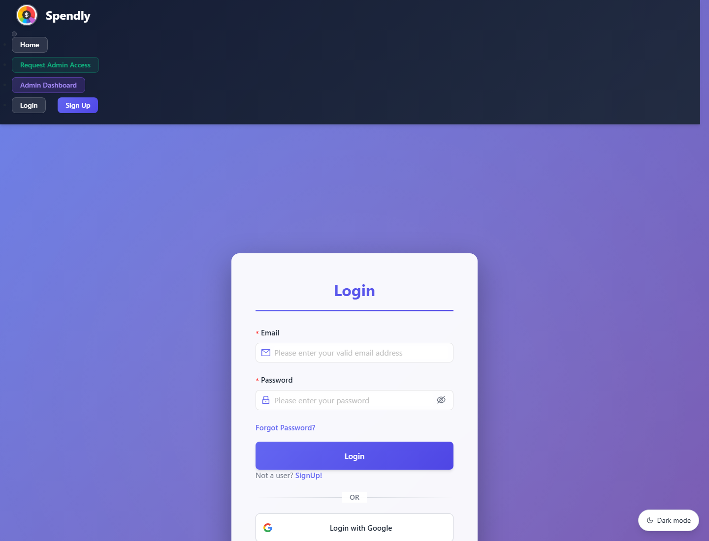
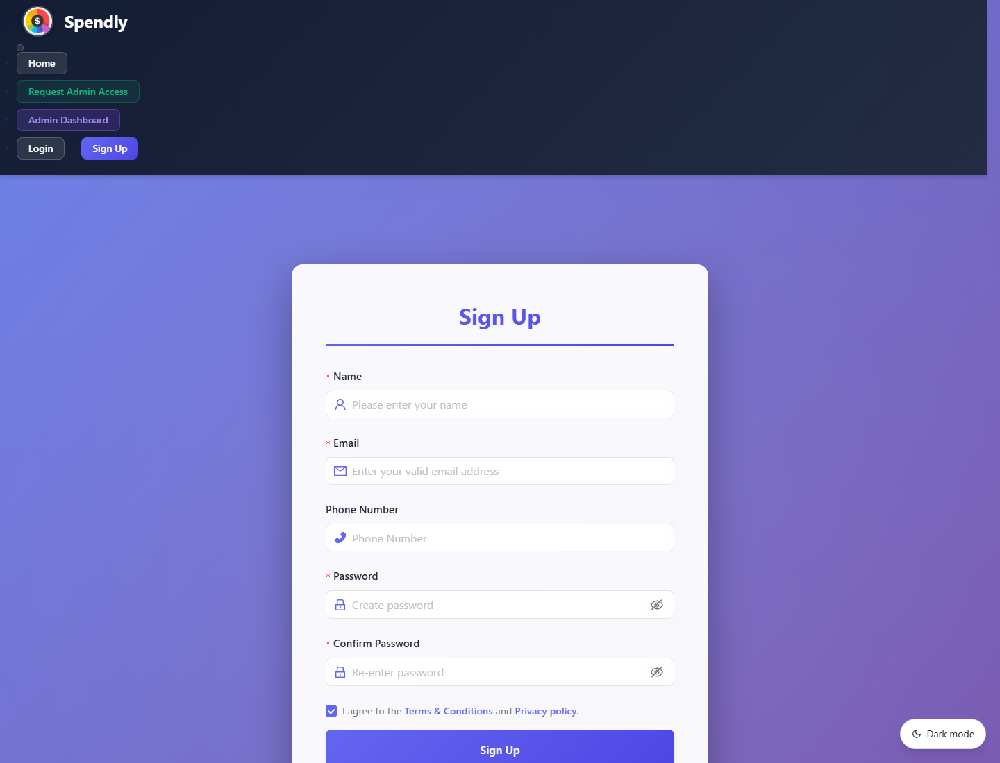
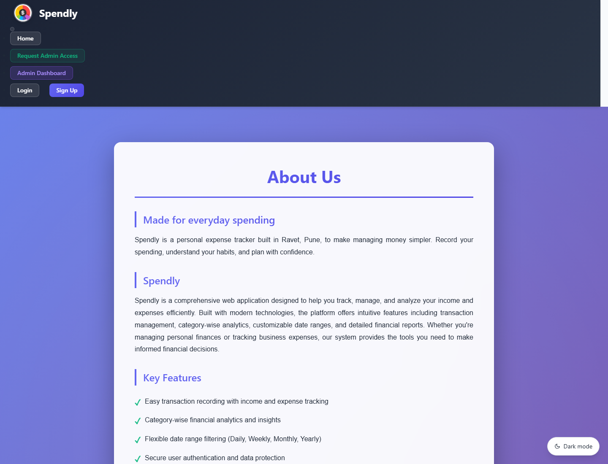

# Spendly

A personal expense tracker to record income and expenses, understand spending patterns, and manage your money.

[Repository](https://github.com/mp8651188-bit/Spendly) · [Maintainer](https://github.com/mp8651188-bit) · [Contact](mailto:mp8651188@gmail.com)

**Status:** Runs locally. A public demo has not been deployed yet.

## Features

- Registration, email verification, login, and password recovery.
- Google sign-in with configured OAuth credentials.
- Add, edit, delete, search, and categorize transactions.
- Filter income and expenses by type and date range.
- Financial summaries and category analytics.
- Export transaction reports to Excel.
- Profile and password management.
- Light and dark themes, contact pages, and an admin area.

## Screenshots

Captured from the local Spendly website. You can preview the design here without running the app.

### Home


### Login



### Registration



### About Spendly



## Tech stack

| Layer | Technologies |
| --- | --- |
| Frontend | React 18, React Router, Ant Design, CSS |
| Backend | Node.js, Express, Passport, JWT, bcrypt |
| Database | MongoDB, Mongoose |
| Email | Nodemailer / SMTP |
| Reports | SheetJS, FileSaver |

## Run locally

Install Node.js and npm, and prepare a MongoDB database. Email features need SMTP credentials; Google sign-in needs OAuth credentials.

```bash
git clone https://github.com/mp8651188-bit/Spendly.git
cd Spendly
npm install --prefix client
npm install --prefix server
```

Create `server/.env` with your own values:

```dotenv
MONGO_URL=mongodb://127.0.0.1:27017/spendly
PORT=8000
BCRYPT_SALT=10
JWT_SECRETE_KEY=replace-with-a-long-random-secret
EXPIRE_IN=7d

EMAIL_HOST=smtp.gmail.com
EMAIL_PORT=465
EMAIL_USER=your-email@example.com
EMAIL_PASS=your-smtp-app-password
EMAIL_FROM=your-email@example.com

GOOGLE_CLIENT_ID=your-google-client-id
GOOGLE_CLIENT_SECRET=your-google-client-secret
GOOGLE_CALLBACK_URL=http://localhost:8000/auth/google/callback

# Only needed for SMS verification:
FAST2SMS_API_KEY=your-fast2sms-api-key
```

Keep credentials and `.env` files out of version control. See [email setup](server/EMAIL_SETUP.md) for SMTP configuration. The backend initializes Google OAuth at startup, so supply valid OAuth configuration when starting it.

Start the backend:

```bash
cd server
node server.js
```

In a separate terminal, from the repository root, start the frontend:

```bash
cd client
npm start
```

Open **http://localhost:3000**. The API runs at **http://localhost:8000**. Local URLs are configured in `client/src/utils/baseURL.js` and `server/utils/baseURL.js`.

## Project structure

```text
client/             React application and frontend assets
server/             Express API, models, authentication, and email services
docs/screenshots/   Current Spendly website screenshots
```

## Maintainer

Spendly is customized and maintained by [@mp8651188-bit](https://github.com/mp8651188-bit).

Contact: [mp8651188@gmail.com](mailto:mp8651188@gmail.com).

## Credits

Based on [Expense Management System by Prakashsaw](https://github.com/Prakashsaw/Expense-Management-System). The original project identifies its license as MIT; preserve applicable original notices when redistributing.
